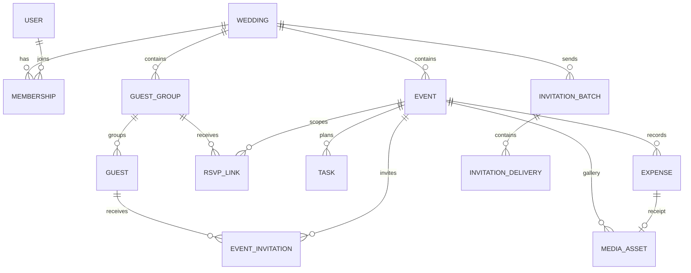

# Database Design: Saath

**Database:** MongoDB Atlas  
**Document style:** Multi-tenant collections with explicit `weddingId` ownership  
**Status:** Draft, aligned with [SDA.md](SDA.md)  
**Version:** 1.0  
**Date:** 3 November 2026

## 1. Design goals

- Keep wedding data isolated by workspace.
- Support multiple events, event-specific guest invitations and RSVPs, tasks, shopping, expenses, receipts, galleries, and livestream links.
- Let family members sign in without passwords and let guests RSVP without accounts.
- Make headcounts and budget totals derive from source records so summary values do not drift.
- Store image and receipt bytes in Cloudflare R2; store only metadata and object keys in MongoDB.
- Keep the first version understandable and easy to operate as a modular monolith.

## 2. Core modeling decisions

### Workspace tenancy

Every wedding-owned document includes `weddingId`. The server resolves the active wedding from the authenticated user’s membership, then includes that `weddingId` in every database query and update. Do not trust a wedding ID supplied by the browser without checking membership.

### References and embedding

- Store reusable entities (wedding, event, guest, expense, task, media) in separate collections.
- Use `ObjectId` references between entities.
- Embed small, bounded values that belong to one record, such as event venue details or the list of people in a household.
- Keep event RSVP responses separate from guest records because each guest can have a different status for each event.

### Time and currency

- Use ISO date-only strings for event calendar dates (`YYYY-MM-DD`) and UTC `Date` values for timestamps.
- Store the wedding IANA time zone, normally `Asia/Kolkata` for an India-based wedding, and use it when interpreting event start/end times.
- Store money in integer minor units. For INR, `amountMinor: 125000` means ₹1,250.00. Do not store money as floating-point values.
- Store a currency code with every budget/expense amount, even if the first UI only supports INR.

### Derived values

Do not store mutable dashboard totals such as “confirmed guests” or “spent so far” in the wedding document. Calculate them from event RSVP and expense records. Add a cache only if real usage later shows the aggregation is too slow.

## 3. Entity relationship overview



`EventInvitation` is the per-event state for one guest. `RsvpLink` gives a household a private, account-free way to update the invited members for one event.

## 4. Collections and example documents

Examples omit internal auth-provider fields and some audit metadata for readability. `_id` values below are illustrative ObjectIds.

### 4.1 `users`

One record per family collaborator account. Authentication credentials and one-time login tokens should be managed by a maintained auth provider/library; do not store raw magic-link secrets here.

```json
{
  "_id": "ObjectId(user1)",
  "emailNormalized": "meera@example.com",
  "displayName": "Meera Patel",
  "authProvider": "passwordless-email",
  "createdAt": "2026-10-01T08:00:00Z",
  "updatedAt": "2026-10-01T08:00:00Z"
}
```

### 4.2 `weddings`

```json
{
  "_id": "ObjectId(wedding1)",
  "ownerUserId": "ObjectId(user1)",
  "title": "Aarav & Meera's Wedding",
  "coupleNames": ["Aarav Sharma", "Meera Patel"],
  "weddingDate": "2027-02-14",
  "timeZone": "Asia/Kolkata",
  "city": "Jaipur",
  "currency": "INR",
  "budgetMinor": 300000000,
  "createdAt": "2026-10-01T08:00:00Z",
  "updatedAt": "2026-10-01T08:00:00Z",
  "schemaVersion": 1
}
```

`budgetMinor` represents ₹3,000,000.00 (₹30 lakh). The application should display values in Indian number formatting and use an agreed unit/format consistently; verify sample figures before importing prototype data.

### 4.3 `memberships`

The join between users and weddings. First version roles: `owner` and `collaborator`.

```json
{
  "_id": "ObjectId(member1)",
  "weddingId": "ObjectId(wedding1)",
  "userId": "ObjectId(user1)",
  "role": "owner",
  "status": "active",
  "invitedByUserId": null,
  "createdAt": "2026-10-01T08:00:00Z",
  "updatedAt": "2026-10-01T08:00:00Z"
}
```

### 4.4 `events`

```json
{
  "_id": "ObjectId(event1)",
  "weddingId": "ObjectId(wedding1)",
  "name": "Mehendi",
  "dateLocal": "2027-02-12",
  "startTimeLocal": "11:00",
  "endTimeLocal": "15:00",
  "timeZone": "Asia/Kolkata",
  "venue": {
    "name": "Garden Terrace",
    "address": "Jaipur, Rajasthan",
    "notes": "Use the east entrance"
  },
  "description": "Welcome lunch and mehendi ceremony",
  "sortOrder": 10,
  "budgetMinor": 50000000,
  "livestream": {
    "url": null,
    "instructions": null,
    "updatedAt": null
  },
  "status": "planned",
  "createdByUserId": "ObjectId(user1)",
  "createdAt": "2026-10-01T08:00:00Z",
  "updatedAt": "2026-10-01T08:00:00Z"
}
```

User-defined event names and order are allowed. `budgetMinor` is optional; the wedding-level budget remains the overall limit.

### 4.5 `guestGroups`

Household/family grouping for invitation convenience. Grouping must not force everyone in the household to give the same RSVP.

```json
{
  "_id": "ObjectId(group1)",
  "weddingId": "ObjectId(wedding1)",
  "name": "Rajesh Sharma household",
  "familySide": "groom",
  "contactName": "Rajesh Sharma",
  "emailNormalized": "rajesh@example.com",
  "phoneE164": "+919876543210",
  "notes": "Call if the invitation email bounces",
  "createdAt": "2026-10-01T08:00:00Z",
  "updatedAt": "2026-10-01T08:00:00Z"
}
```

### 4.6 `guests`

Store attendees as individuals so an RSVP can confirm some household members and decline others.

```json
{
  "_id": "ObjectId(guest1)",
  "weddingId": "ObjectId(wedding1)",
  "guestGroupId": "ObjectId(group1)",
  "displayName": "Rajesh Sharma",
  "relationship": "Uncle",
  "dietaryNotes": "Vegetarian",
  "accessibilityNotes": null,
  "createdAt": "2026-10-01T08:00:00Z",
  "updatedAt": "2026-10-01T08:00:00Z"
}
```

Contact details are stored on the household/contact record rather than duplicated for every family member. Sensitive notes should only be shown to invited collaborators.

### 4.7 `eventInvitations`

One record per guest per event. This is the source of truth for invitations, RSVP state, and event headcounts.

```json
{
  "_id": "ObjectId(eventInvitation1)",
  "weddingId": "ObjectId(wedding1)",
  "eventId": "ObjectId(event1)",
  "guestId": "ObjectId(guest1)",
  "guestGroupId": "ObjectId(group1)",
  "invitationStatus": "sent",
  "rsvpStatus": "confirmed",
  "invitationChannel": "whatsapp",
  "invitationBatchId": "ObjectId(batch1)",
  "responseAt": "2026-11-10T10:30:00Z",
  "createdAt": "2026-10-10T09:00:00Z",
  "updatedAt": "2026-11-10T10:30:00Z"
}
```

Allowed `invitationStatus`: `not_sent`, `queued`, `sent`, `delivered`, `failed`, `cancelled`.  
Allowed `rsvpStatus`: `not_invited`, `awaiting`, `confirmed`, `declined`.

Keep delivery state and RSVP state separate: a delivered message is not an RSVP.

### 4.8 `rsvpLinks`

One link can let a household respond for multiple guests for one event. Store only a hash of the random token.

```json
{
  "_id": "ObjectId(rsvpLink1)",
  "weddingId": "ObjectId(wedding1)",
  "eventId": "ObjectId(event1)",
  "guestGroupId": "ObjectId(group1)",
  "tokenHash": "sha256:...",
  "expiresAt": "2027-02-20T00:00:00Z",
  "revokedAt": null,
  "createdByUserId": "ObjectId(user1)",
  "createdAt": "2026-10-10T09:00:00Z",
  "lastUsedAt": null
}
```

The plaintext token exists only long enough to put into the invitation URL. On RSVP submission, the server resolves the link to the allowed event and guest group, validates expiry/revocation, then updates only matching `eventInvitations`.

### 4.9 `tasks`

Use the same record for tasks and shopping. `kind` is `task` or `shopping`.

```json
{
  "_id": "ObjectId(task1)",
  "weddingId": "ObjectId(wedding1)",
  "eventId": "ObjectId(event1)",
  "kind": "shopping",
  "title": "Buy return gifts",
  "category": "gifting",
  "ownerUserId": "ObjectId(user1)",
  "dueAt": "2027-02-05T18:30:00Z",
  "status": "open",
  "quantity": 100,
  "estimatedCostMinor": 2500000,
  "actualCostMinor": null,
  "notes": null,
  "completedAt": null,
  "createdByUserId": "ObjectId(user1)",
  "createdAt": "2026-10-12T08:00:00Z",
  "updatedAt": "2026-10-12T08:00:00Z"
}
```

### 4.10 `expenses`

```json
{
  "_id": "ObjectId(expense1)",
  "weddingId": "ObjectId(wedding1)",
  "eventId": "ObjectId(event1)",
  "description": "Mehendi artist booking advance",
  "category": "ceremony",
  "amountMinor": 2500000,
  "currency": "INR",
  "paidBy": {
    "type": "family",
    "label": "Patel family"
  },
  "paymentStatus": "paid",
  "expenseDate": "2026-10-12",
  "receiptAssetId": "ObjectId(asset1)",
  "notes": null,
  "createdByUserId": "ObjectId(user1)",
  "createdAt": "2026-10-12T08:00:00Z",
  "updatedAt": "2026-10-12T08:00:00Z"
}
```

`paidBy.type` may be `user`, `family`, or `other`; `label` preserves a readable payer name if a family contribution is not linked to a user account. An expense is not a payment transaction and does not settle balances.

### 4.11 `mediaAssets`

Metadata only; the binary file remains in R2.

```json
{
  "_id": "ObjectId(asset1)",
  "weddingId": "ObjectId(wedding1)",
  "eventId": "ObjectId(event1)",
  "purpose": "receipt",
  "objectKey": "weddings/wedding1/receipts/01J...png",
  "originalFilename": "mehendi-advance.png",
  "contentType": "image/png",
  "sizeBytes": 234001,
  "caption": null,
  "uploaderUserId": "ObjectId(user1)",
  "createdAt": "2026-10-12T08:00:00Z",
  "deletedAt": null
}
```

Allowed `purpose`: `receipt`, `gallery`. Never save permanent signed URLs in this document; generate them after authorization.

### 4.12 `invitationBatches` and `invitationDeliveries`

`invitationBatches` records the confirmed bulk-send operation:

```json
{
  "_id": "ObjectId(batch1)",
  "weddingId": "ObjectId(wedding1)",
  "eventId": "ObjectId(event1)",
  "channel": "whatsapp",
  "createdByUserId": "ObjectId(user1)",
  "recipientCount": 42,
  "messageTemplateKey": "mehendi-invitation-en-v1",
  "status": "processing",
  "confirmedAt": "2026-10-10T09:00:00Z",
  "createdAt": "2026-10-10T09:00:00Z",
  "completedAt": null
}
```

`invitationDeliveries` tracks each recipient and supports retries:

```json
{
  "_id": "ObjectId(delivery1)",
  "weddingId": "ObjectId(wedding1)",
  "batchId": "ObjectId(batch1)",
  "eventId": "ObjectId(event1)",
  "guestGroupId": "ObjectId(group1)",
  "channel": "whatsapp",
  "status": "sent",
  "providerMessageId": "provider-message-id",
  "idempotencyKey": "batch1:group1:whatsapp",
  "attemptCount": 1,
  "lastErrorCode": null,
  "sentAt": "2026-10-10T09:00:03Z",
  "updatedAt": "2026-10-10T09:00:03Z"
}
```

Avoid retaining full rendered message bodies in the delivery record unless needed for audit/support. If stored, define retention and access limits.

### 4.13 `activityEvents`

```json
{
  "_id": "ObjectId(activity1)",
  "weddingId": "ObjectId(wedding1)",
  "actorUserId": "ObjectId(user1)",
  "entityType": "expense",
  "entityId": "ObjectId(expense1)",
  "action": "created",
  "summary": "Added an expense for Mehendi artist booking advance",
  "createdAt": "2026-10-12T08:00:00Z"
}
```

Do not include full phone numbers, email addresses, RSVP tokens, or receipt URLs in activity summaries.

## 5. Index plan

Create indexes as versioned database migrations before enabling the associated feature.

| Collection | Index | Purpose |
|---|---|---|
| `users` | Unique `{ emailNormalized: 1 }` | Resolve account by email |
| `memberships` | Unique `{ weddingId: 1, userId: 1 }` | Prevent duplicate membership |
| `memberships` | `{ userId: 1, status: 1 }` | List a collaborator’s active weddings |
| `events` | `{ weddingId: 1, status: 1, dateLocal: 1, sortOrder: 1 }` | Wedding dashboard and event list |
| `guestGroups` | `{ weddingId: 1, familySide: 1, name: 1 }` | Family group search |
| `guests` | `{ weddingId: 1, guestGroupId: 1, displayName: 1 }` | Household roster |
| `eventInvitations` | Unique `{ eventId: 1, guestId: 1 }` | One invitation/RSVP row per guest per event |
| `eventInvitations` | `{ weddingId: 1, eventId: 1, rsvpStatus: 1 }` | Event headcount and RSVP filters |
| `eventInvitations` | `{ weddingId: 1, guestId: 1 }` | Guest’s event list |
| `rsvpLinks` | Unique `{ tokenHash: 1 }` | Resolve an opaque RSVP token |
| `rsvpLinks` | `{ weddingId: 1, eventId: 1, guestGroupId: 1, revokedAt: 1 }` | Reissue/revoke links |
| `rsvpLinks` | TTL `{ expiresAt: 1 }` | Best-effort expired-token cleanup; application must still validate expiry |
| `tasks` | `{ weddingId: 1, status: 1, dueAt: 1 }` | Due/overdue dashboard tasks |
| `tasks` | `{ weddingId: 1, eventId: 1, status: 1 }` | Event task list |
| `expenses` | `{ weddingId: 1, expenseDate: -1 }` | Recent expenses |
| `expenses` | `{ weddingId: 1, eventId: 1, category: 1 }` | Event and category totals |
| `mediaAssets` | `{ weddingId: 1, eventId: 1, purpose: 1, createdAt: -1 }` | Event gallery and receipts |
| `invitationBatches` | `{ weddingId: 1, createdAt: -1 }` | Recent invitation sends |
| `invitationDeliveries` | Unique `{ idempotencyKey: 1 }` | Prevent duplicate provider sends |
| `invitationDeliveries` | `{ weddingId: 1, batchId: 1, status: 1 }` | Batch progress and retry list |
| `activityEvents` | `{ weddingId: 1, createdAt: -1 }` | Recent activity |

If collection validators are used, define them in migration scripts and validate `weddingId`, enumerated statuses, currency and amount types, required timestamps, and reference IDs. The server remains responsible for cross-document authorization and business rules.

## 6. Key operations and consistency

### Add guests to an event

1. Validate the event belongs to the active wedding.
2. Validate every guest belongs to the same wedding.
3. Upsert one `eventInvitations` record per `(eventId, guestId)` with `invitationStatus: not_sent` and `rsvpStatus: awaiting`.
4. Return per-event counts computed from the invitation records.

### Submit an RSVP

1. Hash the supplied token and find an unexpired, non-revoked `rsvpLinks` record.
2. Verify the event and guest group remain active in the same wedding.
3. Validate the submitted guest IDs are members of that group and invited to that event.
4. Update each matching `eventInvitations` record with the guest’s response.
5. Add an activity record with no token/contact data.

Use a MongoDB transaction for the RSVP updates and activity write if the selected Atlas deployment supports transactions; otherwise make the operation idempotent and recoverable. Never store a separate manually edited event headcount.

### Record an expense with a bill photo

1. Create the expense record or a draft expense.
2. Request an R2 upload URL after checking workspace membership and event access.
3. Upload to the assigned object key and confirm object metadata.
4. Link the asset to the expense.
5. If upload fails, leave the expense intact with a receipt state such as `upload_failed` so the user can retry.

### Update budget and dashboard summaries

- Overall spent = sum of qualifying expense `amountMinor` values for the wedding.
- Event spend = sum where `eventId` matches.
- Separate unpaid/estimated expenses from paid totals in labels and queries.
- Confirm exact semantics for `due`/`estimated` before implementing reports; do not add all statuses to the “paid” sum.
- Confirmed headcount = sum of invited guests whose event response is `confirmed` (one record per person).
- Awaiting count = count of event invitations whose RSVP status is `awaiting`.

## 7. Data access patterns

### Dashboard load

Use a small number of indexed queries/aggregations scoped by `weddingId`:

1. Upcoming active events ordered by local date/time.
2. Task counts and due tasks from `tasks`.
3. RSVP counts grouped by event/status from `eventInvitations`.
4. Budget and category totals from `expenses`.
5. Latest activity from `activityEvents`.

Avoid querying all guests, all receipts, and all expenses into the application just to calculate dashboard cards. Add pagination for guest lists, task lists, expenses, and galleries.

### Event page load

Fetch event by both `_id` and `weddingId`, then load its invitation summary, tasks, expenses, media metadata, and livestream URL. For photo/receipt URLs, issue signed GET links only for the current authorized request.

## 8. Security, privacy, and lifecycle

- All tenant-owned queries include the authenticated `weddingId` from membership resolution.
- Guest RSVP routes are the only unauthenticated write path; scope them to one event and household through the hashed opaque token.
- Store RSVP tokens and authentication tokens as hashes, never plaintext.
- Normalize emails and phone numbers for matching, but preserve display formatting only where needed.
- Keep guest dietary/accessibility notes and expense records out of public RSVP responses unless the guest is editing their own response.
- Use private R2 objects and signed URLs with short lifetimes; do not expose object keys as public access permissions.
- On wedding deletion, use a staged delete: revoke links and memberships, delete R2 objects, then delete or anonymize MongoDB records according to the retention policy.
- Define account removal, workspace deletion, photo deletion, receipt deletion, and backup retention before production launch.

## 9. Migration and schema evolution

- Maintain a `schemaVersion` on the workspace and on records whose shape changes materially.
- Apply forward-only, repeatable migrations for indexes, backfills, and validators.
- Test migrations against a sanitized copy of data before production use.
- Make new fields optional during rollout, then backfill and require them only after old records are migrated.
- Keep stable enum values for statuses; translate to user-facing labels in the application.

## 10. Decisions to finalize during implementation

1. Exact auth and email provider for magic links/codes.
2. Email and WhatsApp delivery providers and webhook formats.
3. Whether dietary/accessibility details are stored per guest globally or per event; this design starts with a guest-level note, with event-specific overrides available later.
4. Receipt and gallery file size/type limits and retention period.
5. Whether invitations can be resent to an individual without creating a new RSVP link.
6. Exact budget semantics for estimated, due, and paid expenses.

## 11. References

- [MongoDB Atlas documentation](https://www.mongodb.com/docs/atlas/)
- [MongoDB Compass connection guide](https://www.mongodb.com/docs/compass/connect/)
- [Cloudflare R2 presigned URLs](https://developers.cloudflare.com/r2/api/s3/presigned-urls/)
- [MongoDB TTL indexes](https://www.mongodb.com/docs/manual/core/index-ttl/)
