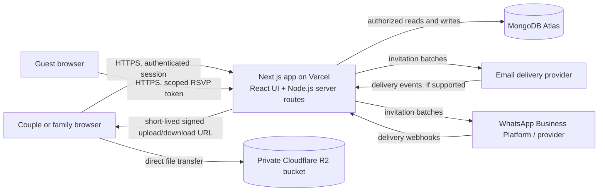

# System Design & Architecture: Saath

**Product:** Simple Indian wedding planning website  
**Status:** Draft architecture based on confirmed product decisions  
**Version:** 1.0  
**Date:** 3 November 2026

## 1. Purpose

Describe a simple, secure first-version architecture for the Saath wedding-planning website. The system serves the couple and invited family collaborators, with an account-free RSVP path for guests.

## 2. Confirmed decisions

| Area | Decision |
|---|---|
| Application style | Modular monolith |
| Web application | Next.js with React, TypeScript recommended |
| Runtime and hosting | Node.js on Vercel |
| Operational database | MongoDB Atlas |
| Database inspection | MongoDB Compass connects to Atlas; Compass is a client tool, not the hosted database |
| File storage | Private Cloudflare R2 bucket for receipts and event photos |
| Family authentication | Passwordless email code or magic link |
| Guest RSVP | Private event invitation link; no guest account required |
| Indian wedding support | User-defined events; optional ceremony examples, never a fixed required sequence |

Next.js provides server-side endpoints alongside the React application, which fits the agreed single-app approach. [Next.js backend-for-frontend guide](https://nextjs.org/docs/app/guides/backend-for-frontend)

## 3. Architecture overview

The application is one repository and one primary deployment. Internal modules keep responsibilities clear without introducing separate microservices. The browser talks to the Next.js application for wedding data and authorization. For uploads and downloads, Next.js verifies access and issues short-lived R2 URLs; the browser transfers the file directly to R2.

### Logical modules inside the monolith

- **Identity and access:** Passwordless family sign-in, workspace membership, roles, RSVP token verification.
- **Wedding workspace:** Couple details, wedding settings, collaborators.
- **Events:** Event CRUD, order, venue, schedule notes, livestream URL.
- **Guests:** Households, contact details, per-event invitations and RSVP state.
- **Invitations:** Recipient selection, message preview, batch status, email/WhatsApp provider adapters, delivery webhooks.
- **Tasks and shopping:** Owners, due dates, categories, completion and purchased state.
- **Budget and expenses:** Budget totals, event/category views, payer, payment state, receipt metadata.
- **Media:** Upload authorization, event gallery metadata, signed view links, deletion.
- **Dashboard:** Read model assembled from events, guests, tasks, and expenses.
- **Activity history:** Actor and timestamp for important edits.

Keep business rules in server-side modules called by Next.js route handlers or Server Actions; avoid putting authorization rules only in React components. Next.js documents route handlers as reachable endpoints and recommends reading the data source directly from Server Components where applicable rather than making an unnecessary HTTP hop through the app itself. [Next.js backend-for-frontend guide](https://nextjs.org/docs/app/guides/backend-for-frontend)

## 4. Main request flows

### 4.1 Family passwordless sign-in

1. Collaborator enters their email address and requests a one-time code or magic link.
2. The authentication provider sends the message. The product stores no reusable password.
3. The collaborator verifies the one-time credential.
4. The server creates a secure session cookie and resolves the user’s wedding memberships.
5. Every subsequent data request checks membership and role server-side.

**Recommendation:** Use a maintained authentication library or service that supports passwordless email, secure sessions, and callback validation. Keep the provider choice configurable. Do not implement token generation, email deliverability, and session cryptography from scratch.

### 4.2 Guest RSVP from a private invitation link

1. The host selects an event and guest households, previews the invitation, and confirms the send.
2. The server creates a high-entropy, event-scoped RSVP token for each household and stores only a hash of each token.
3. The invitation contains an HTTPS link with the opaque token. It does not expose guest IDs, phone numbers, or other personal data in the URL.
4. The guest opens the link and sees only the relevant event and household’s RSVP form.
5. The server validates token scope, expiry, and revocation state, then records the response and attendee count.
6. The dashboard and event headcount update from the saved RSVP record.

Tokens should be revocable and expire after a configured period. Avoid putting sensitive guest data in query parameters or logs. Rate-limit repeated attempts and provide a host-controlled way to resend or revoke a link.

### 4.3 Bulk invitation delivery

1. The host filters guests by event and channel, reviews the recipient count and message preview, and explicitly confirms.
2. The server creates an invitation batch and one delivery record per recipient with an idempotency key.
3. A bounded dispatcher sends messages through an email adapter or WhatsApp adapter and stores provider message IDs and statuses.
4. Provider callbacks update delivered/failed status where supported. Failed messages can be retried without creating a second RSVP token.
5. The host sees delivery status and RSVP status separately; a delivered message does not imply a confirmed RSVP.

Use an outbox/job record in Atlas so a Vercel request does not rely on untracked in-memory background work. Start with bounded batches suitable for wedding-sized lists; keep a queue/worker integration as a scale-up path. WhatsApp business-initiated sends may require provider/account setup and approved message templates; confirm this before implementation estimates. [WhatsApp Business template guidance](https://whatsappbusiness.com/blog/manage-message-templates-whatsapp-business/)

### 4.4 Receipt or photo upload to R2

1. An authenticated collaborator requests an upload for a specific wedding, event, and media purpose.
2. The Next.js server checks workspace membership, allowed file type, file size, and rate limits.
3. It creates a random object key and a short-lived signed PUT URL restricted to the expected content type.
4. The browser uploads directly to the private R2 bucket.
5. The browser confirms completion; the server verifies the object metadata and saves an asset record in Atlas.
6. On gallery/receipt view, the server checks access and issues a short-lived signed GET URL.

R2 supports S3-compatible APIs and presigned `PUT`/`GET` URLs. Treat a presigned URL like a bearer token, use short expiry, restrict the signed content type, and configure bucket CORS for the app origin. R2 presigned URLs use the S3 API domain rather than a custom domain. [Cloudflare R2 S3 API docs](https://developers.cloudflare.com/r2/api/s3/), [R2 presigned URL documentation](https://developers.cloudflare.com/r2/api/s3/presigned-urls/)

## 5. Data model (MongoDB Atlas)

Every tenant-owned record carries `weddingId`. The server derives that ID from verified membership and applies it to all reads and writes; never trust a client-supplied wedding ID alone.

| Collection | Important fields | Notes |
|---|---|---|
| `users` | `_id`, `email`, `displayName`, `createdAt` | Family collaborators only; auth provider subject can be stored here |
| `weddings` | `_id`, `ownerUserId`, `coupleNames`, `weddingDate`, `city`, `currency`, `budget`, `createdAt` | Workspace root |
| `memberships` | `weddingId`, `userId`, `role`, `invitedAt`, `joinedAt` | Unique index on `(weddingId, userId)` |
| `events` | `weddingId`, `name`, `date`, `startAt`, `endAt`, `venue`, `notes`, `sortOrder`, `livestream` | Event belongs to one wedding |
| `guestHouseholds` | `weddingId`, `familyGroup`, `name`, `email`, `phone`, `attendees[]`, `dietaryNotes`, `accessibilityNotes` | Household-level records reduce duplicate family entries |
| `eventGuestResponses` | `weddingId`, `eventId`, `householdId`, `status`, `attendeeCount`, `updatedAt` | Separate response per event; unique `(eventId, householdId)` |
| `tasks` | `weddingId`, `eventId`, `title`, `category`, `ownerUserId`, `dueAt`, `status`, `shopping`, `quantity`, `estimatedCost`, `actualCost` | Supports checklist and shopping view |
| `expenses` | `weddingId`, `eventId`, `description`, `amountMinor`, `currency`, `category`, `payer`, `paymentStatus`, `receiptAssetId`, `createdAt` | Store money as integer minor units (e.g. paise), not floating point |
| `mediaAssets` | `weddingId`, `eventId`, `purpose`, `objectKey`, `contentType`, `sizeBytes`, `uploaderUserId`, `caption`, `createdAt` | Private R2 object reference; do not store signed URL as permanent data |
| `invitationBatches` | `weddingId`, `eventId`, `channel`, `createdBy`, `status`, `createdAt`, `confirmedAt` | Records the host-confirmed send action |
| `invitationDeliveries` | `weddingId`, `batchId`, `householdId`, `channel`, `providerMessageId`, `status`, `attemptCount`, `lastErrorCode` | Idempotent per batch/recipient/channel |
| `rsvpTokens` | `weddingId`, `eventId`, `householdId`, `tokenHash`, `expiresAt`, `revokedAt`, `createdAt` | Unique token hash; never store plaintext token |
| `activityEvents` | `weddingId`, `actorUserId`, `entityType`, `entityId`, `action`, `createdAt` | Lightweight audit history for important updates |

### Suggested indexes

- `memberships`: unique `(weddingId, userId)` and lookup by `userId`.
- `events`: `(weddingId, date, sortOrder)`.
- `guestHouseholds`: `(weddingId, familyGroup)`; optional normalized contact indexes for duplicate assistance.
- `eventGuestResponses`: unique `(eventId, householdId)` and `(weddingId, eventId, status)`.
- `tasks`: `(weddingId, status, dueAt)` and `(weddingId, eventId, status)`.
- `expenses`: `(weddingId, eventId, createdAt)` and `(weddingId, category, createdAt)`.
- `mediaAssets`: `(weddingId, eventId, createdAt)`.
- `invitationDeliveries`: `(weddingId, batchId, status)` and unique idempotency key.
- `rsvpTokens`: unique `tokenHash`; expiry cleanup may use a TTL index, while request validation still checks expiry explicitly.

## 6. API and server boundaries

Use Next.js App Router. Use Server Components for initial, permission-checked reads; Server Actions or Route Handlers for mutations and external callbacks. Webhook endpoints must validate provider signatures and be idempotent.

Illustrative endpoints (exact URL naming can be set during implementation):

- `POST /api/auth/request-link`, `POST /api/auth/verify`
- `POST /api/weddings`, `GET/PATCH /api/weddings/:weddingId`
- `GET/POST/PATCH/DELETE /api/events/:eventId`
- `GET/POST/PATCH /api/events/:eventId/guests`
- `POST /api/invitations/preview`, `POST /api/invitations/send`
- `POST /api/invitations/webhooks/email`, `POST /api/invitations/webhooks/whatsapp`
- `GET/POST/PATCH /api/tasks`, `GET/POST/PATCH /api/expenses`
- `POST /api/media/upload-url`, `POST /api/media/confirm`, `GET /api/media/:assetId/url`, `DELETE /api/media/:assetId`
- `GET /rsvp/:token`, `POST /api/rsvp/:token`
- `GET /api/dashboard`

## 7. Security and privacy

- Enforce wedding membership and role checks in server-side code on every protected operation.
- Use secure, HTTP-only, same-site session cookies; rotate/revoke sessions when access is removed.
- Store magic-link/code and RSVP token hashes, with short validity and one-time or scoped use.
- Apply rate limits to authentication, RSVP, invitation, and upload URL routes.
- Validate input server-side; use allowlists for file types and size limits. Consider malware/content scanning before allowing broad distribution of uploaded files.
- Keep R2 private. Generate short-lived links only after access checks; avoid permanent public object URLs for receipts and private galleries.
- Never log full guest contacts, auth tokens, RSVP tokens, signed file URLs, or message bodies unnecessarily.
- Keep provider credentials in Vercel environment secrets; do not send secrets to client code.
- Make destructive actions confirmable and record important edits in the activity history.
- Provide host actions to revoke a guest RSVP token, remove a collaborator, and delete a photo/receipt.

## 8. Deployment and operations

### Environments

- Separate development/preview and production configuration.
- Prefer separate Atlas databases/clusters and R2 buckets (or clearly separated prefixes with scoped credentials) for non-production and production.
- Configure allowed origins, callback URLs, email/WhatsApp webhooks, and R2 CORS per environment.
- Store secrets as deployment environment variables. Include MongoDB URI, auth/email settings, R2 endpoint/bucket/access keys, invitation provider credentials, and webhook secrets.

### Runtime

- Deploy the Next.js application to Vercel using its supported Next.js integration.
- Use Node.js-compatible handlers for database access, signed URL creation, and provider integration.
- Keep handlers bounded and idempotent. Persist invitation batch state before external dispatch and delivery callbacks after dispatch.
- Use Vercel deployment previews for review without connecting them to production guest data or file buckets.

Next.js supports Node.js server and Docker deployments with full framework support; static export does not support features that require a server. This application needs server routes for auth, database access, signing uploads, RSVPs, and message delivery. [Next.js deployment guide](https://nextjs.org/docs/app/getting-started/deploying)

### Observability and recovery

- Capture structured logs with request ID, wedding ID, operation, and outcome, while excluding secrets and unnecessary personal data.
- Monitor failed sign-ins, failed invitation batches, provider webhook failures, upload failures, and database errors.
- Enable Atlas backups appropriate to the chosen plan and document a restore procedure.
- Keep media deletion in sync: remove the R2 object and its Atlas metadata; retry or surface failures.
- Establish a retention and deletion policy for guest contact data, receipts, and photos before production use.

## 9. Quality attributes

- **Simplicity:** One app and one primary database; no microservices for the first release.
- **Tenant isolation:** All reads/writes scoped to a verified wedding workspace.
- **Availability:** If invitation providers or R2 are unavailable, core planning data remains usable; show delivery/upload state and retry safely.
- **Consistency:** Guest counts and budget totals derive from source records; avoid manually maintained duplicate totals.
- **Performance:** Dashboard uses bounded queries and indexes; paginate large guest lists and galleries.
- **Accessibility:** Mobile-friendly layouts, readable contrast, keyboard navigation, and clear form errors.
- **Localization readiness:** Store dates and currency as structured values; display INR/Indian date formats by workspace locale, with future language support possible.

## 10. Key risks and mitigations

| Risk | Mitigation |
|---|---|
| R2 upload link is shared or leaked | Short expiry, one object/action per URL, private bucket, and server authorization before signing |
| RSVP link is forwarded | Scope token to one event/household; allow host revocation and reissue; avoid sensitive details on RSVP page |
| WhatsApp bulk delivery is not immediately available | Isolate provider adapter; confirm business onboarding/template requirements early; pilot with email and host-assisted WhatsApp sharing if setup is pending |
| A Vercel request is interrupted during sending | Persist an outbox/batch record and make delivery idempotent; use bounded dispatch and provider callbacks |
| Guest or expense data leaks across weddings | Derive tenant scope from verified membership and test access checks for every query path |
| Costs change or totals disagree | Store amounts as integer paise; aggregate from expense records; label estimates separately from paid expenses |
| Photo/receipt storage grows unexpectedly | File size/type caps, quotas per wedding, deletion tools, and monitoring |

## 11. Phased implementation

### Phase 1: Core shared planning

- Passwordless family access and private wedding workspace.
- Events, dashboard, guests and per-event RSVP statuses.
- Tasks/shopping and expense tracking.
- Atlas data model and tenant authorization.

### Phase 2: Invitations and media

- Guest account-free RSVP links.
- Email invitations and delivery tracking.
- WhatsApp integration after business/provider readiness is confirmed.
- R2 upload/download flow for receipts and event galleries.
- Livestream URL and instructions per event.

### Phase 3: Pilot hardening

- Invitation retry/recovery, usage limits, activity history, accessibility, backup/restore rehearsal, and user feedback improvements.

## 12. Decisions still open for implementation

These do not block this architecture but should be selected before development begins:

1. Which passwordless authentication and email delivery provider to use.
2. Whether WhatsApp uses Meta’s Cloud API directly or an approved provider.
3. Exact upload limits, allowed formats, and media retention policy.
4. Vercel plan and region, plus Atlas deployment region, so app-to-database latency and data residency can be considered together.
5. Whether family collaborators need separate viewer/editor roles in addition to owner/collaborator.

## 13. Reference links

- [Next.js backend-for-frontend guide](https://nextjs.org/docs/app/guides/backend-for-frontend)
- [Next.js deployment guide](https://nextjs.org/docs/app/getting-started/deploying)
- [MongoDB Compass connection guide](https://www.mongodb.com/docs/compass/connect/)
- [Cloudflare R2 S3-compatible API](https://developers.cloudflare.com/r2/api/s3/)
- [Cloudflare R2 presigned URLs](https://developers.cloudflare.com/r2/api/s3/presigned-urls/)
- [WhatsApp Business message template guidance](https://whatsappbusiness.com/blog/manage-message-templates-whatsapp-business/)
